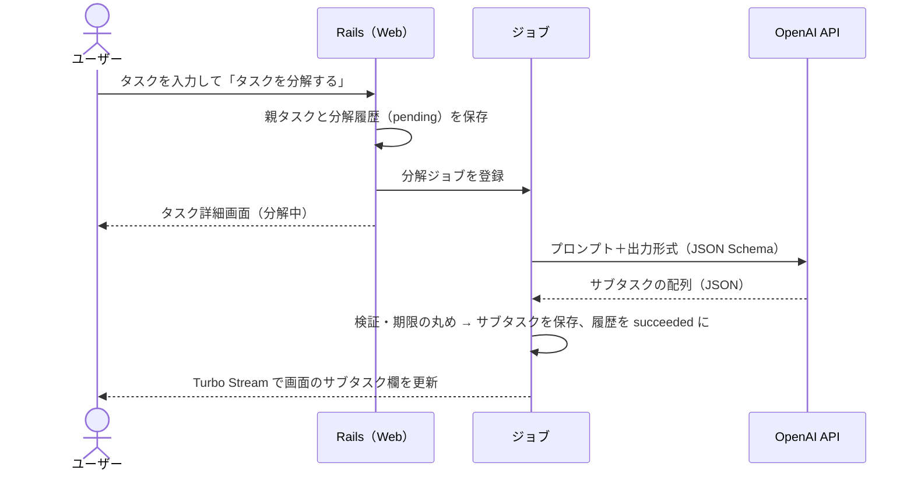

# AI タスク分解の設計

## 処理の流れ



- AI 呼び出しはリクエスト処理の中で行わず、**必ずジョブで非同期に実行**する（画面が固まらないように）
- 結果は Turbo Stream でリアルタイムに画面へ反映する（再読み込み不要）

## 構成

| 要素 | 配置 | 役割 |
|---|---|---|
| LLM クライアント | `app/services/llm/` | AI API の呼び出しを隠す境界。本番用（OpenAI）とテスト用（固定応答）を環境変数 `LLM_CLIENT` で切り替える |
| 分解サービス | `app/services/task_decomposer.rb` | プロンプトの組み立て、応答の検証・整形、サブタスクの保存 |
| プロンプト | `app/services/task_decomposer/prompt.rb` | システムプロンプト・ユーザープロンプト・出力 JSON Schema |
| ジョブ | `app/jobs/decompose_task_job.rb` | 分解サービスの実行と画面更新の配信 |

## プロンプト設計

### システムプロンプトの要点
1. 役割: 社会人経験の長いベテラン社員として、新入社員のタスクを分解する
2. 各サブタスクは「〜する」で終わる、着手に迷わない具体的な行動にする
3. 他者の返答待ち・承認待ちが発生する工程（依頼・事前確認・承認）を見落とさず、早い順番に置き、`kind = special` にする
4. 社内手続き（起案・稟議・申請・経費精算など）では、ベテランが必ず踏む工程を省略しない
   - 最初の手順で、その手続きの社内規程・基準（決裁基準・決裁権限、勘定科目・経費規程など）を確認する
   - 起案・稟議など決裁が必要な手続きでは、本申請・提出の前に上司へ事前相談して承認をもらう手順を置き、`kind = special` にする
   - 手順名には「決裁基準」「勘定科目」「承認」など業務で使う言葉をそのまま使う
5. 不備があった場合の修正時間を見込む
6. 実行順に並べる
7. 親タスクに期限がある場合、現在日時から逆算して各サブタスクの期限を提案する（親の期限を超えない）
8. ペルソナの 3 事例（見積・起案書・経費申請）を**分解例（few-shot）**として含める

### ユーザープロンプトに渡す情報
- 現在日時（ISO 8601、Asia/Tokyo）
- 親タスクのタイトル・説明・期限
- 件数の指示（粒度により変える）

| 粒度 | 件数 |
|---|---|
| normal（既定・再分解） | 3〜8 件 |
| finer（もっと細かく） | 6〜12 件 |
| coarser（もっとざっくり） | 2〜4 件 |

### 出力形式（Structured Outputs, strict）

```json
{
  "subtasks": [
    {
      "title": "仕入れ先に見積もりを依頼する",
      "description": "15 時までに依頼し、当日中に回答をもらう",
      "kind": "special",
      "estimated_minutes": 15,
      "due_at": "2026-10-26T15:00:00+09:00"
    }
  ]
}
```

| フィールド | 型 | 必須 | 説明 |
|---|---|---|---|
| title | string | ○ | サブタスク名 |
| description | string \| null | ○ | 補足説明 |
| kind | `"basic"` \| `"special"` | ○ | 特殊タスク＝他者の対応待ちが発生する |
| estimated_minutes | integer \| null | ○ | 目安の所要時間（分） |
| due_at | string \| null | ○ | ISO 8601（タイムゾーン付き）。親に期限がなければ null |

## 応答の検証と整形

| ケース | 扱い |
|---|---|
| サブタスクが 0 件 | 失敗として扱う |
| 13 件以上 | 先頭 12 件のみ採用 |
| タイトルが空 | その要素を捨てる |
| タイトルが 200 文字超 | 200 文字に切り詰める |
| `due_at` が解釈できない | 期限なしとして保存 |
| `due_at` が現在より前 | 期限なしとして保存 |
| `due_at` が親タスクの期限より後 | 親タスクの期限に丸める |

## 失敗時の挙動

| 失敗 | 対応 |
|---|---|
| タイムアウト（接続 10 秒・応答 60 秒）・HTTP エラー（5xx・レート制限など） | ジョブを 2 秒おきに最大 2 回再実行する（合計 3 回）。それでも失敗したら分解履歴を `failed` にしてエラー内容を記録し、画面に「分解に失敗しました。再度お試しください」と「再分解する」ボタンを出す |
| 応答が JSON として不正 | 同上 |
| 有効なサブタスクが 0 件 | 再実行せず、分解履歴を `failed` にして同じ失敗表示を出す |
| API キー未設定 | `LLM_CLIENT` も未設定なら固定応答のクライアントで動く（エラーにはならない）。`LLM_CLIENT=openai` で API キーが無いときは分解実行時にエラーとし、上と同じく失敗として記録する |

- 失敗しても既存のサブタスクは変更しない（保存はトランザクション内で行う）
- 失敗の詳細（API の応答本文を含む）は画面に出さず、分解履歴（`decompositions.error_message`）で確認する
- 分解に失敗したタスクでも、サブタスクを手動で追加・編集・完了できる

## 再分解

MVP では、分解に失敗したタスクの「再分解する」ボタンからだけ再分解できる。分解履歴（`pending`）を新しく作ってジョブを登録し、成功すると AI のサブタスクを既存のサブタスク（手動で追加したもの）に追加する。分解中にもう一度押しても、ジョブと履歴は重ねて作らない。

分解に成功したあとのやり直し（再分解・もっと細かく・もっとざっくり。UC-8）は拡張で、次の方針とする。
- 「未完了かつ AI が生成した」サブタスクだけを置き換える
- 手動で追加したサブタスク・完了済みのサブタスクは残す

## 設定（環境変数）

| 変数 | 既定値 | 説明 |
|---|---|---|
| `LLM_CLIENT` | API キーがあれば `openai`、なければ `fake` | `fake` は API キー不要の固定応答（開発・テスト用）。「見積もり作成」の 3 手順を返し、期限は実行時刻の 1〜3 時間後になる |
| `OPENAI_API_KEY` | — | OpenAI の API キー。`.env` に置き、コミットしない |
| `OPENAI_MODEL` | `gpt-5-mini` | 使用モデル |

## 品質評価（AI 評価セット）

AI の出力は毎回変わるため、通常のテストとは別に**評価セット**で品質を確認する。プロンプトやモデルを変えたときに、ベテランの分解に含まれる観点が落ちていないかを 3 事例で機械的に採点する。

### 評価事例

ペルソナの 3 事例を `spec/evals/cases/<事例名>.yml` に固定入力として置く（rspec の実行対象ではない）。

| 事例名 | 内容 | 親タスクの期限 |
|---|---|---|
| `estimate` | 営業「見積もり作成」 | 評価時刻の 8 時間後 |
| `proposal` | 社内業務「起案書」 | 評価時刻の 5 日後 |
| `expense` | 社内業務「経費申請」 | 評価時刻の 3 日後 |

各ファイルの項目:

| 項目 | 説明 |
|---|---|
| `label` / `title` / `description` | 表示名、親タスクのタイトル・補足 |
| `due_in` | 親タスクの期限。評価時刻からの相対（`30m` / `8h` / `3d`）で書き、固定日付にしない |
| `expect.count` | 件数の範囲（`min` / `max`。3〜8 件） |
| `expect.aspects` | 含むべき観点（`name` と `keywords`）。サブタスクのタイトルがキーワードのどれかを含めば、その観点の手順とみなす |
| `expect.order` | 観点の順序（例: 起案書は「決裁基準の確認」→「上司の承認」→「起案書の申請」）。複数の列を書ける |
| `expect.special` | 他者の返答・承認待ちになる観点。その観点の手順のどれかが `special` であること |

### 採点項目（ルールベース）

| 区分 | OK の条件 |
|---|---|
| 件数 | サブタスクの件数が `expect.count` の範囲内 |
| 観点 | 観点ごとに、該当する手順が 1 件以上ある |
| 順序 | 列の隣り合う観点 A → B について、A の手順のどれかが B の手順のどれかより前にある |
| special | `expect.special` の観点ごとに、該当する手順のどれかが `special` |
| 期限の範囲 | すべてのサブタスクに期限があり、評価時刻〜親タスクの期限の範囲内（現在時刻を分単位に丸めた応答を許すため、下限は評価時刻の 1 分前まで許容） |
| 期限の順序 | 期限が実行順（前の手順の期限 ≦ 後の手順の期限）に並ぶ |

採点するのは AI の応答そのもの（「応答の検証と整形」の丸めを行う前）。全項目が OK の事例を合格とする。

### 実行方法

`bin/rails eval:decompose` で全事例、`bin/rails "eval:decompose[estimate]"` で 1 事例を実行する。本番と同じプロンプトで分解し、事例ごとに採点表（区分・項目・判定・理由）を出力する。

- 親タスクは保存しない（DB に何も書き込まない）
- 不合格の事例があれば終了コード 1
- API キーと AI の応答（JSON）は出力しない。応答を確認したいときは `EVAL_VERBOSE=1` を付ける
- 実 API を使うため CI では実行しない。CI で動くのは採点ロジックの spec（`spec/lib/evals/`）だけ

**ドライラン（API キー不要）**: 固定応答のクライアントで、コマンドと採点表の動きを確かめる。

```sh
docker compose run --rm -e LLM_CLIENT=fake web bin/rails "eval:decompose[estimate]"
```

固定応答は「見積もり作成」の分解なので、合格するのは `estimate` だけ。引数なしで 3 事例を回すと `proposal`（起案書）と `expense`（経費申請）は不合格になり、終了コードは 1 になる。

**実 API での評価**: プロンプト・モデルを変えたときに手動で実行し、出力を PR に貼る。

```sh
docker compose run --rm -e OPENAI_API_KEY=<API キー> web bin/rails eval:decompose
```

### 合格基準

- 3 事例とも、ルールベースの全項目が OK
- AI の出力は揺れるため、各事例は 2 回まで実行し、1 回でも合格すれば合格とする（1 事例だけ再実行するときは `eval:decompose[<事例名>]`）
