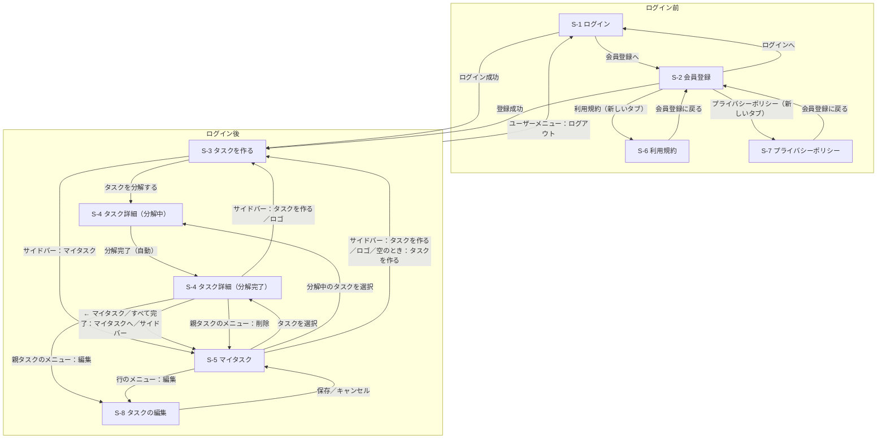

# 画面設計

デザインは Figma のデザインデータ（Tasklet）に準拠する。

## 画面一覧

| ID | 画面名 | URL | ログイン | 対応 UC |
|---|---|---|---|---|
| S-1 | ログイン | `/session/new` | 不要 | UC-7 |
| S-2 | 会員登録 | `/registration/new` | 不要 | UC-7 |
| S-3 | タスクを作る（ホーム） | `/` | 必要 | UC-1 |
| S-4 | タスク詳細（分解結果） | `/tasks/:id` | 必要 | UC-2〜5, 9 |
| S-5 | マイタスク（親タスク一覧） | `/tasks` | 必要 | UC-5, 6, 9 |
| S-6 | 利用規約 | `/terms` | 不要 | UC-7 |
| S-7 | プライバシーポリシー | `/privacy` | 不要 | UC-7 |
| S-8 | タスクの編集 | `/tasks/:id/edit` | 必要 | UC-1 |

ログインが必要な画面をログインせずに開くと S-1 へ移り、ログインするとその画面に戻る。ログイン済みで S-1・S-2 を開くと S-3 へ移る。他のユーザーのタスクの URL を開くと「見つかりません」（404）になる。

## 画面遷移図

ログイン前の画面（S-1・S-2・S-6・S-7）のロゴも S-3 へのリンク（ログインしていなければ S-1 に戻される）。分解したタスクは S-5 マイタスクに期限の近い順で並ぶ。分解中の S-4 は、分解が終わると再読み込みなしで分解完了（または分解失敗）の表示に切り替わる（URL は変わらない）。

## 共通レイアウト

- **ログイン後の画面（S-3〜S-5、S-8）**: 左にサイドバー（幅 232px）
  - ロゴ「Tasklet」（S-3 へのリンク）
  - ナビゲーション：タスクを作る／マイタスク（現在の画面をハイライト。S-4 タスク詳細・S-8 タスクの編集ではマイタスクをハイライト）
  - 下部にユーザー情報（アバター・名前・メールアドレス）とユーザーメニュー「…」。メニューは上向きに開き、項目は「ログアウト」（S-1 へ遷移）。メールアドレスが長いときは末尾を省略する
- **ログイン前の画面（S-1, S-2, S-6, S-7）**: サイドバーなし。中央にロゴとフォーム（S-6・S-7 は本文）のカード。ロゴは S-3 へのリンク（ログインしていなければ S-1 へ移る）。画面下部に「© Tasklet」を置く（ログイン前の画面だけの意図的な表示）
- **ヘッダーバー**（高さ 68px、メイン領域の全幅）は S-4・S-5 にだけ置く。S-3 は入力に集中させるためヘッダーバーを置かない
  - 左には現在地（S-5「マイタスク」）または戻り先（S-4「← マイタスク」）を 1 つだけ置く。パンくずは使わない
  - 右に「完了済みを表示」ボタンを置く。初期状態では完了済みのサブタスク・親タスクを隠し、押すと表示して表記が「完了済みを隠す」に変わる。もう一度押すと隠す
- **メニュー「…」**: 押すと項目の一覧が開き、項目の外側をクリックするか Esc キーで閉じる（Esc ではメニューのボタンにフォーカスが戻る）。開いたときは最初の項目にフォーカスが移り、↑ ↓ で項目を移り（端で反対側へ回る）、Home／End で先頭・末尾へ移る。Tab でメニューの外へフォーカスが移っても閉じる。「削除」は赤字で表示し、押すと「本当に削除しますか？」の確認を出してから削除する
- **お知らせ**: 保存・削除などの結果は、ログイン後の画面の右上（ヘッダーバーの下）に重ねて表示する（例：「タスクを作成しました」「タスクを更新しました」「タスクを削除しました」「アカウントを登録しました。」）。ヘッダーバーや見出しには重ならず、画面を押し下げない。右端の「×」（お知らせを閉じる）で消せ、結果のお知らせは 5 秒で自動的に消える。失敗のお知らせ（例：「タスクの作成に失敗しました」）は赤で表示し、閉じるまで残す
- **分解ステータス**: 分解中（橙・点滅する点）／分解完了（緑）／分解失敗（赤）。S-4 の見出しの上に表示する。S-5 の各行には分解中・分解失敗のときだけ期限の横に表示する（分解完了は表示しない）
- **対象は PC 幅のみ**。サイドバーは 232px 固定で、狭い幅（モバイル／タブレット）への対応は行わない
- **キーボード操作**: リンク・ボタンはフォーカス時に緑のリング（`ring-brand-dot`。白地・背景色の上でもコントラスト 3:1 以上）を表示する。S-5 の各行はカード全体がリンクなので、リンクにフォーカスしたときはカード全体をリングで囲む。サイドバーの現在地は `aria-current` で支援技術にも伝える

### 見出しの型

| 型 | 対象 | 構成 |
|---|---|---|
| 認証 | S-1, S-2, S-6, S-7 | 英字の小見出し（eyebrow）→ 見出し 32px → 説明文 13px |
| ホーム | S-3 | アイコン → eyebrow → 見出し 44px → 説明文 14px |
| 一覧・詳細 | S-4, S-5 | eyebrow の位置に分解ステータス（S-4）または「MY TASKS」（S-5）→ 見出し 40px（行間 1.45）→ 説明文 11px |
| 編集 | S-8 | eyebrow → 見出し 32px |

見出しはすべてセリフ体・太字。eyebrow は 11px・字間広め・緑。

### 文字サイズ

| サイズ | 主な用途 |
|---|---|
| 10px | 補足説明、種別バッジ・ステータス・期限、進捗、小さいボタン、入力例チップ |
| 11px | eyebrow、ラベル、説明文、日付見出し、日付タブ |
| 13px | サイドバーのナビゲーション、ヘッダーの画面名、サブタスク名、主要ボタン、S-3 の期限入力、S-6・S-7 の本文 |
| 15px | S-3 の入力欄 |
| 17px | S-5 の親タスク名 |
| 32px | S-1・S-2・S-6・S-7・S-8 の見出し |
| 40px | S-4・S-5 の見出し |
| 44px | S-3 の見出し |

このほか、ロゴ（18px／20px）、サイドバーのユーザー名（12px）、フォームの入力欄と S-3 の説明文（14px）、認証画面下部のリンク文（12px）がある。10px より小さい文字は使わない。

### 期限の表記

期限は日時で持ち、S-4・S-5 とも同じ書式で表示する。

| 期限 | 表示 |
|---|---|
| 今日 | 今日 17:00 |
| 明日 | 明日 12:00 |
| それ以外 | 11/1 17:00（M/D HH:MM） |
| 未設定 | 期限なし |

S-4 の日付タブ（今日／明日／M/D）と S-5 の日付見出し（今日／明日／M/D／期限なし）は日付部分だけを表示する。

## 主な操作

入力した内容はすべて保存され、再読み込みしても残る。S-4 のサブタスクの操作は画面全体を読み込み直さず、その場で一覧と進捗を書き換える。

| 操作 | 画面 | 結果 |
|---|---|---|
| ログイン／ログアウト | S-1・ユーザーメニュー | ログインすると S-3（または開こうとしていた画面）へ、ログアウトすると S-1 へ移る |
| アカウントを作成する | S-2 | アカウントを作成してログインし、S-3 へ移る |
| タスクを分解する（送信）・入力例チップ | S-3 | 親タスクを保存して分解中の S-4 へ移り、AI の分解を始める |
| 再分解する | S-4（分解失敗のとき） | もう一度 AI に分解させる。分解中の表示に戻り、終わると自動で切り替わる |
| 親タスクの編集・削除 | S-4 の親タスクのメニュー・S-5 の行のメニュー | 編集は S-8 を開く。削除は確認のあと、サブタスクごと削除して S-5 へ移る |
| タスクを追加 | S-4 | 一覧に入力欄付きのカードを出し、「保存」でサブタスクを追加する |
| サブタスクの編集・削除 | S-4 のサブタスクのメニュー | 編集はカードをその場で入力欄に変える。削除は確認のあと一覧から消す |
| 完了チェック | S-4 | 完了・未完了を切り替え、進捗も変わる |
| 日付タブ | S-4 | 選んだ日が期限のサブタスクだけを表示する |
| 完了済みを表示／隠す | S-4・S-5 | 完了済みのサブタスク・親タスクを表示する／隠す（画面を開き直すと隠した状態に戻る） |

## 各画面の要素

### S-1 ログイン
| 要素 | 内容 |
|---|---|
| 見出し | WELCOME BACK ／ おかえりなさい |
| 入力 | メールアドレス、パスワード（いずれも必須） |
| ボタン | ログイン（未入力の項目があると送信されない） |
| リンク | 会員登録 |
| エラー表示 | メールアドレスかパスワードが違うときは、フォームの上に「メールアドレスまたはパスワードが正しくありません。」と表示する。短時間（3 分以内）に 10 回を超えて送信すると「時間をおいて再度お試しください。」と表示し、受け付けない |

入力値は URL に含めずに送る。ログイン状態はログアウトするまで保つ（「ログイン状態を保持する」のチェックは置かない）。パスワードの再設定は拡張（UC-10）とし、画面には置かない。

### S-2 会員登録
| 要素 | 内容 |
|---|---|
| 見出し | CREATE ACCOUNT ／ はじめましょう |
| 入力 | お名前、メールアドレス、パスワード（8 文字以上。入力欄の下に「8文字以上で入力してください」）、パスワード（確認）（いずれも必須） |
| チェック | 利用規約とプライバシーポリシーに同意する（必須）。「利用規約」「プライバシーポリシー」は S-6・S-7 を新しいタブで開くので、入力途中の内容は残る。新しいタブで開くことを同意文の下に表示する |
| ボタン | アカウントを作成する（未入力の項目・8 文字未満のパスワード・同意のチェック漏れがあると送信されない） |
| リンク | ログイン |

送信するとアカウントを作成してそのままログインし、S-3 へ移る。入力値は URL に含めずに送る。

入力に誤りがあるときは保存せず、フォームの上に「入力内容をご確認ください：」と次のようなエラーの一覧を表示する（入力した内容はパスワードを除いて残る）。

| 条件 | 表示 |
|---|---|
| お名前が空・50 文字を超える | お名前を入力してください／お名前は50文字以内で入力してください |
| メールアドレスが空・形式が不正・登録済み | メールアドレスを入力してください／メールアドレスは不正な値です／メールアドレスはすでに存在します |
| パスワードが 8 文字未満 | パスワードは8文字以上で入力してください |
| パスワード（確認）が一致しない | パスワード（確認）とパスワードの入力が一致しません |
| 利用規約に同意していない | 利用規約とプライバシーポリシーに同意してください |

同意のチェックはサーバでも確かめ、チェックが無い送信は登録しない。同意したときは同意した日時を記録する。

ログインと同じく、短時間（3 分以内）に 10 回を超えて送信すると、フォームの上に「時間をおいて再度お試しください。」と表示し、受け付けない。

メールアドレスは前後の空白を除き、小文字にそろえて保存する。

### S-3 タスクを作る
| 要素 | 内容 |
|---|---|
| 見出し | AI TASK ASSISTANT ／ 今日は何に取り組みますか？ |
| 入力 | 自由文（必須、最大 200 文字。上限は入力欄の下に「200 文字まで」と表示する。背景や制約も含めて書いてよい。プレースホルダ：例：来週の経営会議に向けて、新規事業の提案資料を作りたい（背景や制約も書けます）） |
| 期限 | 期限（任意、日時）。現在より前の日時は選べない |
| 操作 | タスクを分解する（⌘ / Ctrl + Enter でも送信。期限の入力欄からも送信できる）。空欄・空白だけでは送信されない |
| 入力例チップ | イベントの企画を進める／資格試験の学習計画を立てる／引っ越しの準備をする。押すと入力欄に例文が入る |

送信すると親タスクを保存して分解中の S-4 へ移り、入力した自由文を親タスク名、期限を親タスクの期限として表示する。期限を入れなかったときは「期限なし」と表示し、サブタスクの期限は親の期限で丸めない。

空欄・空白だけの入力と 200 文字を超える入力は、ブラウザの検証で送信を止める。それでも送られた不正な値（空のタスク名・現在より前の期限など）は保存せず、S-3 のフォームの上にエラーの一覧（例：「期限は現在より前の日時を設定できません」）を、画面の上部に「タスクの作成に失敗しました」を表示する。

### S-6 利用規約・S-7 プライバシーポリシー
| 要素 | 内容 |
|---|---|
| 見出し | TERMS OF SERVICE ／ 利用規約、PRIVACY POLICY ／ プライバシーポリシー |
| 冒頭の注記 | 両ページとも本文の先頭に「Tasklet は、ハッカソンのために制作したデモ用のサービスです。デモ期間中の試用を目的として提供しており、正式なサービスではありません。」を置く |
| 本文 | 番号付きの節に分けて書く（下表） |
| リンク | 会員登録に戻る（S-2 へ） |

| ページ | 節の構成 |
|---|---|
| S-6 利用規約 | 1. 本規約について ／ 2. サービスの内容（AI がタスクを手順に分解すること、AI の提示は参考情報であること）／ 3. デモとしての提供（継続提供・可用性・データの保全を保証しない）／ 4. 禁止事項（第三者の個人情報や機密情報の入力、なりすまし、運営の妨害など）／ 5. アカウントとデータの削除（運営チャンネルで依頼、サービス終了時に全削除）／ 6. 規約の変更 ／ 7. お問い合わせ（ハッカソンの運営チャンネル） |
| S-7 プライバシーポリシー | 1. 取得する情報（氏名・メールアドレス・パスワード（ハッシュ化して保存）、規約に同意した日時、タスク・サブタスクの内容と期限・完了の記録、AI への送信内容と分解結果の履歴、セッション情報（User-Agent・IP アドレス））／ 2. 利用目的 ／ 3. AI サービスへの送信（タスク名・補足説明・期限を OpenAI の API に送る。氏名・メールアドレスは送らない）／ 4. Web フォントの読み込み（画面表示のため Google Fonts を読み込み、その際ブラウザから Google に IP アドレス等が直接送られる）／ 5. 第三者への提供（AI サービスへの送信のほかには行わない。Web フォントの読み込みで送られる情報は本サービスからの提供ではない）／ 6. 保存期間（デモ期間中。終了時に削除）／ 7. 削除の依頼（運営チャンネル）／ 8. Cookie の利用（ログイン状態を保つセッション ID と、フォーム送信を安全に受け付けるための情報のみ）／ 9. 本ポリシーの変更 |

連絡先として個人のメールアドレスは載せず、問い合わせはハッカソンの運営チャンネルに集める。

### S-4 タスク詳細
| 要素 | 内容 |
|---|---|
| ヘッダー | ← マイタスク（S-5 へ戻る）、完了済みを表示／隠す |
| ステータス | 分解中／分解完了／分解失敗（見出しの上） |
| 見出し | 親タスク名、説明文（ステータスごとに下表）、親タスクのメニュー（編集・削除）。編集は S-8 を開き、削除は確認のあとサブタスクごと削除して S-5 へ移る |
| 親タスクの期限・進捗 | 見出しの下に期限（時刻付き。未設定は「期限なし」）と進捗（「n/m 完了」とプログレスバー。サブタスクが無いときは「—」）。進捗はサブタスクの完了・追加・削除に合わせてその場で変わる |
| 日付タブ | すべて／今日／明日／サブタスクの期限に含まれるそのほかの日付（M/D）。押すとその日が期限のサブタスクだけに絞り込み、「すべて」で全件に戻る。期限なしのサブタスクは「すべて」にだけ表示。最初は「すべて」を選んだ状態で、選んだタブに下線が付く。日付タブは「日付で絞り込む」ナビゲーションとして読み上げ、選んだタブを `aria-current` で支援技術にも伝える |
| 該当するサブタスクが無いとき | 選んだ日付のタブにサブタスクが 1 件も無いときは、一覧の代わりに「該当するサブタスクはありません」と「ほかの日付か「すべて」のタブで確認できます。」を表示する |
| サブタスクが 1 件も無いとき | 分解に失敗した・すべて削除したなどでサブタスクが 1 件も無いときは、一覧の代わりに「サブタスクはまだありません」と「「タスクを追加」から手順を追加できます。」を表示する。「タスクを追加」で入力欄を開いている間は表示しない |
| サブタスクカード | 完了チェック、番号、タスク名、種別バッジ（基本／特殊）、補足説明（2 行まで）、期限（時刻付き。例：今日 17:00）、メニュー（編集・削除）。一覧は期限の近い順で、期限なしは末尾。番号は表示中の一覧での並び順 |
| 種別バッジ | 基本＝自分だけで進められる手順／特殊＝他者の確認・承認・返答待ちが発生する手順（早めに着手する） |
| 期限なしのサブタスク | 期限の欄に「期限なし」を表示し、押すとそのカードの編集欄が開いて期限を設定できる |
| 完了チェック | 押すと完了になり、「完了済みを表示」していなければ一覧から消える。表示中は塗りつぶしたチェックと打ち消し線で示し、もう一度押すと未完了に戻る |
| すべて完了したとき | タスク全体のサブタスクがすべて完了したときは、一覧の代わりに「すべての手順が完了しました」、「完了済みを表示」で確認できる旨の案内、「マイタスクへ」（S-5 へ） |
| 選んだ日付の手順がすべて完了したとき | 日付タブで選んだ日の手順がすべて完了して隠れ、ほかの日にまだ未完了の手順があるときは、一覧の代わりに「選んだ日付の手順はすべて完了しました」と、「完了済みを表示」で確認できる旨の案内を表示する（「すべての手順が完了しました」は出さない） |
| 追加 | 「タスクを追加」を押すと、一覧の末尾にサブタスク名・補足説明（任意）・期限の入力欄が付いたカードが出る（サブタスク名にカーソルが移る）。「保存」で追加し、一覧を期限の近い順に並べ直す。「キャンセル」で入力欄を閉じる。分解失敗のときも使える |
| 編集 | サブタスクのメニューの「編集」で、カードがその場でサブタスク名・補足説明・期限の入力欄に変わる。「保存」で反映し、「キャンセル」で元の表示に戻る。期限を空にすると「期限なし」になる |
| 入力エラー | サブタスク名が空、期限が現在より前、または親タスクの期限より後のときは保存せず、入力欄の上にエラー（例：「期限は親タスクの期限を超える日時を設定できません」）を表示する |

ステータスごとの表示:

| ステータス | 説明文 | 一覧 |
|---|---|---|
| 分解中 | AI が実行しやすい手順に分解しています。通常 30 秒以内に完了します。 | 日付タブと一覧の代わりに読み込み中のカード 3 枚。分解が終わると自動で分解完了の表示に切り替わる。進捗は「—」 |
| 分解完了 | AI が実行しやすい手順に分解しました。内容は自由に編集できます。 | 日付タブとサブタスクカード |
| 分解失敗 | 分解に失敗しました。再度お試しください | 「再分解する」ボタンと、手動で追加したサブタスクの一覧・「タスクを追加」。AI が使えないときもサブタスクを手で追加して進められる |

再分解できるのは分解に失敗したときだけで、「再分解する」ボタンから行う。分解に成功したあとのやり直し（再分解・もっと細かく・もっとざっくり）は拡張（UC-8）とし、画面には置かない。失敗の詳細（AI サービスの応答）は画面に出さない。

親タスクは手動で完了にしない。サブタスクがすべて完了すると親タスクも完了（S-5 で完了済みとして扱う）になり、未完了のサブタスクを追加すると未完了に戻る。

### S-5 マイタスク
| 要素 | 内容 |
|---|---|
| ヘッダー | 現在地「マイタスク」（リンクなし）、完了済みを表示／隠す |
| 一覧 | 親タスク（大カテゴリ）を、日付ごとの見出し（今日・明日・M/D・期限なし）の下に期限の近い順で表示 |
| 各行（カード） | 期限（時刻付き。例：明日 12:00／期限なし）、親タスク名、進捗（例：2/5 完了とプログレスバー。サブタスクが無いときは「—」）、メニュー「…」。マウスを重ねると影が付く。分解中・分解失敗のタスクは期限の横に分解ステータス（分解中／分解失敗）を表示し、一覧で見分けられるようにする。分解完了のタスクには表示しない |
| 行の操作 | カード（メニュー「…」以外）を押すとタスク詳細（S-4）へ移る。メニュー「…」の項目は編集（S-8 を開く）・削除（確認のあと、サブタスクごと削除する）で、メニューを開いても画面は移らない |
| 完了済みを表示／隠す | 初期状態では全完了の親タスク（サブタスクがすべて完了したもの）を隠す。押すと打ち消し線付きで表示する。日付ごとの見出しの下がすべて全完了の親タスクのときは、見出しごと隠す |
| 完了済みですべて隠れたとき | 一覧の代わりに「表示できるタスクはありません」と、「完了済みを表示」で確認できる旨の案内 |
| 空のとき | 親タスクが 1 件も無いときは、一覧の代わりに「まだタスクがありません」「やりたいことを入力すると、AI が手順に分解します。」と「タスクを作る」（S-3 へ）。ヘッダーと見出しはそのまま表示する |

### S-8 タスクの編集
| 要素 | 内容 |
|---|---|
| 見出し | EDIT TASK ／ タスクの編集 |
| 入力 | タスク名（必須、最大 200 文字）、期限（任意、日時） |
| ボタン | 変更を保存する（保存すると S-5 へ移り「タスクを更新しました」を表示する）、キャンセル（S-5 へ戻る） |
| エラー表示 | タスク名が空・期限が現在より前などのときは保存せず、フォームの上にエラーの一覧と、画面の上部に「タスクの更新に失敗しました」を表示する |

親タスクの期限を変えても、すでにあるサブタスクの期限は変わらない。
